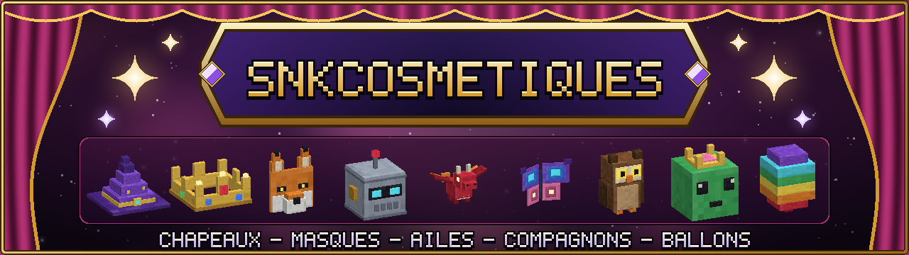
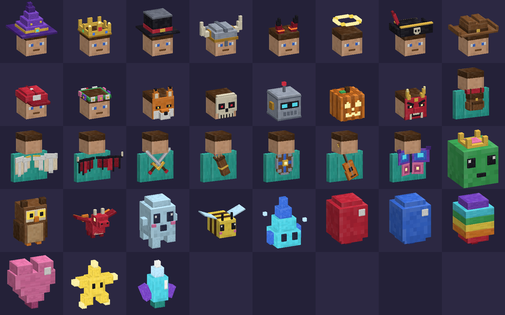
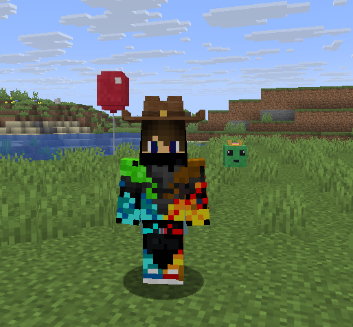
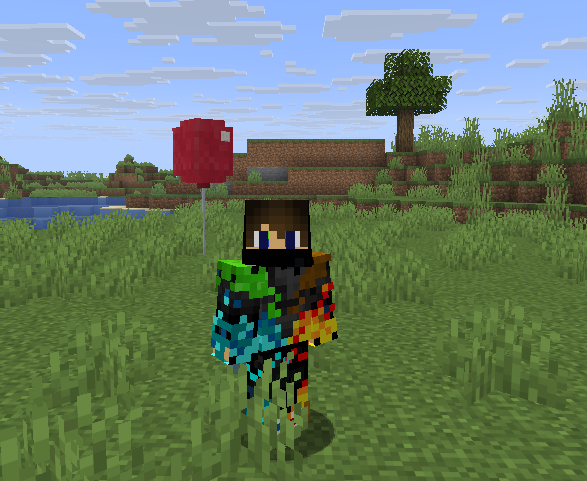
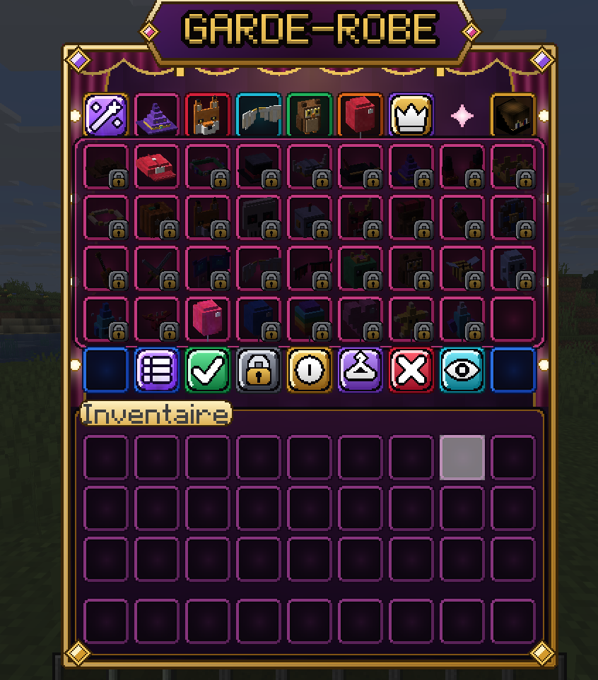

<b>35 cosmétiques en 3D, une garde-robe complète, et rien dans l'inventaire.</b> 
Plugin Minecraft pour serveurs <b>Paper 1.21.4 à 26.3</b>, par <b>SnkAlex</b>.

<a href="#-fonctions">Fonctions</a> •
<a href="#-les-35-cosmétiques">Cosmétiques</a> •
<a href="#-captures">Captures</a> •
<a href="#-commandes">Commandes</a> •
<a href="#-compatibilité">Compatibilité</a> •
<a href="#-lobtenir">L'obtenir</a>

---

## ✨ Fonctions

### 👗 Une garde-robe
- Tous les cosmétiques dans un seul menu, avec leur **vrai modèle 3D**
- Onglets **Tous / Possédés / Non possédés** et un filtre par catégorie
- **Un clic pour porter, un clic pour enlever**
- Les cosmétiques à gagner sont grisés avec un cadenas, et le menu dit **comment les obtenir**
- **Essai de 15 secondes** avant d'acheter
- **3 tenues** à enregistrer et à remettre en un clic

### 🎒 Rien dans l'inventaire
- Aucun objet n'est donné : rien à perdre, rien à jeter, rien à dupliquer
- Le **vrai casque reste porté et protège toujours**, même sous un chapeau
- Les téléportations et les portails marchent normalement

### 🤝 Porter plusieurs choses à la fois
Un chapeau **ou** un masque, plus un objet de dos, un compagnon qui te suit et un ballon.

### 🔓 Plusieurs façons de les gagner
Gratuit, argent du jeu, votes, heures de jeu, pass de saison, permission ou commande admin. Tout se choisit cosmétique par cosmétique dans un fichier.

### 👁️ Du respect pour les joueurs
- Chacun peut **masquer les cosmétiques des autres**
- Ils sont **cachés** si le joueur est invisible ou spectateur

### ⚖️ Aucun avantage en jeu
Ce sont seulement des apparences : elles ne donnent ni force, ni protection.

---

## 🎩 Les 35 cosmétiques

| Catégorie | Nombre | Exemples |
|---|---|---|
| Chapeaux | 10 | Sorcier, couronne, viking, pirate, cow-boy, auréole |
| Masques | 5 | Renard, crâne, robot, citrouille, oni |
| Dos | 8 | Ailes d'ange, de démon et de papillon, épées croisées, guitare |
| Compagnons | 6 | Bébé dragon, chouette, abeille, petit fantôme, roi slime |
| Ballons | 6 | Arc-en-ciel, cœur, étoile, cristal |

4 raretés : commun, rare, épique et légendaire.

 Les 35 modèles (aperçu dessiné hors du jeu)

---

## 📸 Captures

<table>
<tr>
<td align="center" width="50%"> Chapeau de cow-boy, ballon rouge et roi slime</td>
<td align="center" width="50%"> Le ballon flotte à côté du joueur</td>
</tr>
</table>

 La garde-robe

---

## ⌨️ Commandes

| Commande | Effet |
|---|---|
| `/cosmetiques` (ou `/cosmetique`, `/cosmetics`, `/cos`) | La garde-robe |
| `/cosmetiques tenues` | Les 3 tenues |
| `/cosmetiques enlever` | Enlève tout |
| `/cosmetiques admin donner <joueur> <id>` · `retirer <joueur> <id>` | Donner ou reprendre un cosmétique (admin) |
| `/cosmetiques admin vote <joueur>` · `reload` | Compter un vote, recharger (admin) |

**Permissions :** `snkcosmetiques.admin`, `snkcosmetiques.tout`, `snkcosmetiques.<id>`.

---

## 🧩 Compatibilité

| | |
|---|---|
| **Versions** | 1.21.4 à 26.3, un seul fichier pour toutes |
| **Testé sur** | Paper 1.21.4, 1.21.11, 26.2 et 26.3 |
| **Serveur** | Paper |
| **Java** | 21 ou plus (celui de ta version de Paper) |
| **Pack de ressources** | Obligatoire (fourni) : les joueurs sans le pack ne voient aucun cosmétique |
| **Conseillé** | Vault et une économie |
| **Facultatif** | Votifier / NuVotifier |

**Va plus loin avec les autres plugins Snk** (facultatifs) :
- **[SnkQuetes](https://github.com/SnkStudio/SnkQuetes)** : des cosmétiques à gagner en finissant des quêtes
- **[SnkPNJ](https://github.com/SnkStudio/SnkPNJ)** : des personnages qui portent chapeaux et masques
- **[SnkInterface](https://github.com/SnkStudio/SnkInterface)** : la garde-robe dans un menu principal, chat, TAB et hologrammes
- **[SnkPass](https://github.com/SnkStudio/SnkPass)** : des cosmétiques à gagner dans le pass ; ses titres, couleurs et particules apparaissent dans la garde-robe
- **[SnkMetiers](https://github.com/SnkStudio/SnkMetiers)** : de l'argent à gagner pour les acheter

---

## 📦 Ce que tu reçois
- Le plugin (`.jar`)
- Le pack de ressources : les 35 modèles et les menus
- Le guide d'installation et le guide complet, en français

Aucune connaissance en code n'est nécessaire : tout se règle dans deux fichiers.

---

## 📩 L'obtenir

Le plugin n'est pas en téléchargement libre. Pour le prix, une question ou une démonstration :

➡️ **[Écris-moi ici](../../issues/new/choose)** (il faut un compte GitHub, c'est gratuit)

> Les messages sont **publics** : n'écris ni adresse e-mail, ni mot de passe, ni information de paiement. On passe ensuite en privé.

---

© SnkAlex. Tous droits réservés. Voir <a href="LICENSE.md">la licence</a>. 
Ce plugin n'est pas un produit officiel Minecraft. Il n'est ni approuvé par Mojang ou Microsoft, ni associé à eux.

